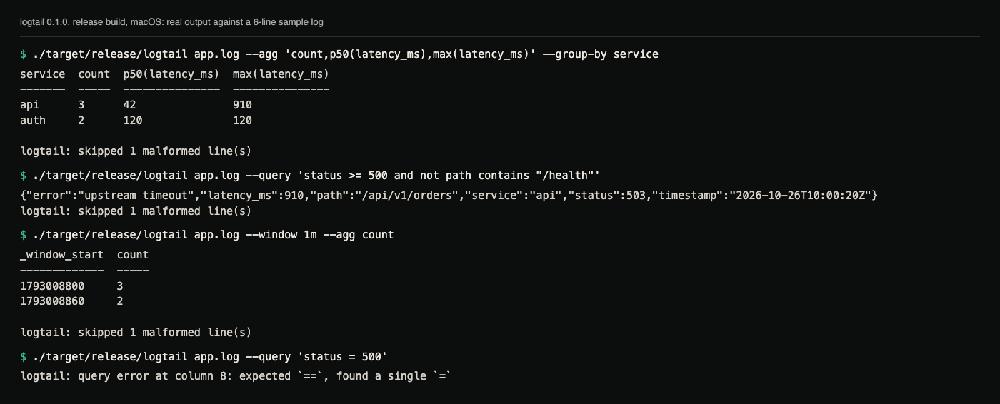
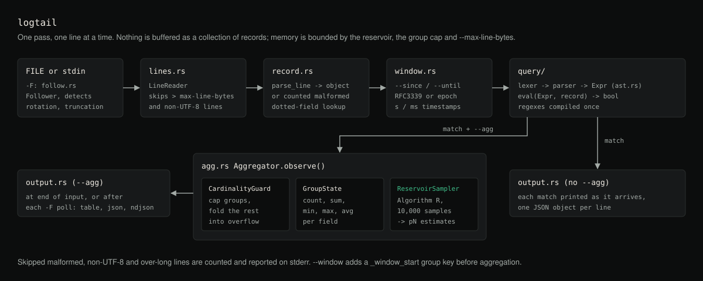

# logtail

Filter and aggregate high-volume structured JSON logs with a real query
language, streaming throughout so a multi-gigabyte file never has to fit in
memory.

**Status:** version 0.1.0. A single-binary CLI built from source; it is not
published to crates.io. 98 tests pass on Linux, macOS and Windows in CI.

## What

`logtail` reads newline-delimited JSON (NDJSON) logs, one JSON object per
line, and lets you:

- Filter records with a small expression language (`status >= 500 and not
  path contains "/health"`).
- Aggregate matched records: `count`, `sum`, `avg`, `min`, `max`, and
  percentiles (`p50`, `p90`, `p95`, `p99`, or any `pN`), optionally grouped
  by one or more fields.
- Restrict to a time range (`--since`/`--until`) or bucket into tumbling
  time windows (`--window`) for a time series.
- Follow a live file (`-F`/`--follow`) the way `tail -f` does, but survive
  the file being rotated out from under it.
- Emit a table for a terminal, or JSON/NDJSON for piping into another tool.

Everything is streaming: `logtail` reads one line at a time and never loads
the whole file into memory, regardless of file size (see
[Performance](#performance) for a measured 402 MB / 3,000,000-line run).
Per-line memory is capped too: a line longer than `--max-line-bytes`
(default 1 MiB) is skipped and counted without being buffered, and a line
that is not valid UTF-8 is skipped and counted as malformed instead of
aborting the run.

## Why

`grep` and `awk` can filter lines, but they cannot answer "what's the p99
latency by endpoint for the last 5 minutes, excluding health checks" without
turning into a small essay of pipeline stages, and they have no concept of
nested JSON fields or numeric comparison against a JSON number. Shipping
every log line to a hosted observability platform to ask that question is
slow to set up and not free, and often the log file you need is already
sitting right there on disk or scrolling past in a live tail. `logtail` is
the tool for that: a real query language and real aggregations, running
locally, streaming, with bounded memory.

## Demo



Real output from the release build against the six-line `app.log` below
(one line is deliberately not JSON, which is why every run reports a skipped
line on stderr). After [building](#installation), create the file and run:

```sh
cat > app.log <<'EOF'
{"timestamp":"2026-10-26T10:00:05Z","service":"api","status":200,"path":"/api/v1/items","latency_ms":42}
{"timestamp":"2026-10-26T10:00:20Z","service":"api","status":503,"path":"/api/v1/orders","latency_ms":910,"error":"upstream timeout"}
{"timestamp":"2026-10-26T10:00:40Z","service":"api","status":500,"path":"/health","latency_ms":3}
{"timestamp":"2026-10-26T10:01:10Z","service":"auth","status":200,"path":"/login","latency_ms":120}
{"timestamp":"2026-10-26T10:01:30Z","service":"auth","status":401,"path":"/login","latency_ms":95}
not json at all
EOF
./target/release/logtail app.log --agg 'count,p50(latency_ms),max(latency_ms)' --group-by service
```

```text
service  count  p50(latency_ms)  max(latency_ms)
-------  -----  ---------------  ---------------
api      3      42               910
auth     2      120              120

logtail: skipped 1 malformed line(s)
```

```sh
./target/release/logtail app.log --query 'status >= 500 and not path contains "/health"'
```

```text
{"error":"upstream timeout","latency_ms":910,"path":"/api/v1/orders","service":"api","status":503,"timestamp":"2026-10-26T10:00:20Z"}
logtail: skipped 1 malformed line(s)
```

```sh
./target/release/logtail app.log --window 1m --agg count
```

```text
_window_start  count
-------------  -----
1793008800     3
1793008860     2

logtail: skipped 1 malformed line(s)
```

## Query language reference

### Grammar

```text
expr       := or_expr
or_expr    := and_expr ( "or" and_expr )*
and_expr   := not_expr ( "and" not_expr )*
not_expr   := "not" not_expr | primary
primary    := "(" expr ")" | has_expr | comparison
has_expr   := "has" field
comparison := field ( cmp_op literal | "~" string | "contains" string )
field      := ident ( "." ident )*
cmp_op     := "==" | "!=" | ">" | ">=" | "<" | "<="
literal    := number | string | "true" | "false" | "null"
```

Precedence, loosest to tightest: `or` < `and` < `not` < comparison/parens.
So `a or b and c` parses as `a or (b and c)`, and `not a and b` parses as
`(not a) and b`. Use parentheses to override.

An empty query (`--query ""` or no `--query` at all) matches every record.

### Operators

| Syntax | Meaning |
| --- | --- |
| `field == value` | Equality (numbers, strings, booleans, or `null`) |
| `field != value` | Inequality |
| `field > / >= / < / <=` | Numeric or lexicographic string ordering |
| `field ~ "regex"` | Regex match (field must be a string) |
| `field contains "substr"` | Substring match (field must be a string) |
| `has field` | Field is present and not JSON `null` |
| `not expr` | Boolean negation |
| `a and b`, `a or b` | Boolean composition |
| `( expr )` | Grouping |

### Nested fields

`http.request.method == "GET"` walks into nested JSON objects. If any
segment of the path is missing, or the value at that point isn't an object,
the field is treated as absent.

### Null and type-mismatch handling

A comparison against a missing field is always false, `!=` included: for
the records `{"a":1}`, `{"a":null}` and `{"b":2}`, `a != null` matches only
the first, and `a != 5` also matches only the first. Comparing mismatched
JSON types (`status == "200"` against a numeric `status`, or `a != 5` when
`a` is `null`) is false rather than an error, because real logs are
heterogeneous. To include records that lack the field, negate the whole
comparison: `not a == 1` matches the second and third records.

### Errors

Malformed queries report a 1-based column position rather than a stack
trace:

```text
$ logtail app.log --query 'status = 500'
logtail: query error at column 8: expected `==`, found a single `=`
```

## Aggregations

Specify one or more with `--agg`, comma-separated:

- `count`
- `sum(field)`, `avg(field)` (alias `mean`), `min(field)`, `max(field)`
- `p50(field)` / `median(field)`, `p90(field)`, `p95(field)`, `p99(field)`,
  or any `pN(field)` for a custom percentile

Combine with `--group-by field1,field2` to compute per-group results. With
no `--group-by`, aggregates run over the whole stream.

### Percentile accuracy trade-off

Percentiles are computed over a **fixed-capacity reservoir sample**
(10,000 values by default, `--reservoir-capacity` to change it), not the
full data set. This is what makes `p99(latency_ms)` over a 10 GB file run
in bounded memory instead of buffering every value: memory use for
percentiles is `O(reservoir_capacity)`, independent of how many records
were observed.

The trade-off is approximation: for a stream of `n` values with capacity
`c`, the standard error of a reported percentile is approximately
`sqrt(p(1-p)/c)`, independent of `n` once `n > c`. In practice this means
p50/p90 are accurate to a fraction of a percentage point at the default
capacity, while extreme tails (p99.9 and beyond) are noisier because fewer
sampled points land there. If you need exact percentiles and the data set
comfortably fits in memory, raise `--reservoir-capacity` above the total
row count for that group.

### Cardinality guard

`--group-by` on an unexpectedly high-cardinality field (a raw request ID, a
URL with a query string) would otherwise grow the group table without
bound. `logtail` caps the number of distinct groups at
`--cardinality-limit` (default 10,000); once the cap is hit, further new
keys are folded into a single overflow bucket and a warning is printed
reporting how many additional values were folded in, rather than the
process silently consuming unbounded memory.

## Architecture



*Diagram of the per-line pipeline, drawn from the modules in `src/`.*

```text
  file/stdin              lexer/parser        evaluator
 ───────────►  raw line ──────────────► Expr ──────────► bool ─┐
  (LineReader,              (query/)          (query::eval)    │ matched
   line at a time)                                              │
                                                                  ▼
                                              ┌── raw record ──► output (table/json/ndjson)
                                              │
                        Aggregator.observe() ─┘── group-by key + cardinality guard
                              │                     │
                              ▼                     ▼
                      per-group FieldStats:   overflow GroupState
                      count/sum/min/max +
                      ReservoirSampler (percentiles)
```

Key modules (`src/`):

- `lines.rs` - `LineReader`, which reads one line at a time, skips lines
  longer than `--max-line-bytes` without buffering them, and flags
  non-UTF-8 lines.
- `query/{lexer,parser,ast,eval}.rs` - the query language: hand-written
  recursive-descent parser producing an `Expr` tree, evaluated directly
  against `serde_json::Value` records (no compilation to bytecode; the tree
  is small and evaluation is already the fast path).
- `reservoir.rs` - `ReservoirSampler`, a bounded-memory percentile
  estimator (Algorithm R reservoir sampling).
- `cardinality.rs` - `CardinalityGuard`, the bounded-group-by-key tracker.
- `agg.rs` - `Aggregator` and `GroupState`, tying group-by, the
  cardinality guard, and per-field reservoirs together.
- `follow.rs` - `Follower`, tailing a file with rotation/truncation
  detection (identity comparison plus a length/handle-vs-path check - see
  [Follow mode and log rotation](#follow-mode-and-log-rotation) for the
  platform-specific details).
- `window.rs` - `--since`/`--until` parsing and tumbling-window bucketing.
- `output.rs` - table/JSON/NDJSON rendering.
- `record.rs` - dotted-field lookup and tolerant NDJSON line parsing.

The whole pipeline is single-pass and streaming: `main.rs` reads one line,
parses it, evaluates the query, and either emits it immediately (raw
filter) or folds it into the aggregator. Records are never buffered as a
collection.

## Follow mode and log rotation

`-F`/`--follow` needs to notice when the file at `path` has been *replaced*
(logrotate-style: move the old file aside, create a new one at the same
name) rather than just appended to, or it would silently keep reading from
the old, now-disconnected file, which is the classic way `tail -f` goes stale.
`logtail` detects this differently per platform, and it is worth being
precise about what each approach can and cannot see:

- **Unix**: uses the file's inode number (`ino`). A rename-based rotation
  always changes the inode the path resolves to, so this is a reliable,
  textbook check.
- **Windows**: there is no stable-Rust equivalent of an inode.
  `std::os::windows::fs::MetadataExt::file_index` exists but sits behind
  the unstable `windows_by_handle` Cargo feature and does not build on
  stable Rust; obtaining the real NTFS file ID would require an `unsafe`
  FFI call into `GetFileInformationByHandle`, and this crate forbids
  `unsafe` entirely (`unsafe_code = "forbid"`). Instead, `logtail` uses the
  file's creation timestamp (`Metadata::created`, stable and safe) as a
  rotation signal, backed by a second, platform-independent check: an
  already-open file handle keeps reporting the size of whatever file it
  actually refers to, even after the path has been repointed at a
  different file, while a fresh stat of the path sees the new file: a
  mismatch there means rotation happened, independent of the timestamp
  check.

  The known gap on Windows: NTFS file-system tunnelling can make the OS
  reuse a deleted file's creation timestamp for a same-named file created
  shortly afterward (on the order of seconds). If that happens *and* the
  replacement file happens to be exactly the same byte length as the file
  it replaced at the moment `logtail` checks, rotation could be missed.
  This is a real, documented limitation of doing rotation detection
  without `unsafe`/unstable APIs on Windows - not a silently assumed-away
  one.

What follow mode prints: `logtail` first reads the whole existing file,
then polls every 300 ms for appended lines. Without `--agg`, each new match
is printed as it arrives. With `--agg`, nothing is printed for the existing
content; each time new lines arrive the full cumulative aggregation table is
printed again, so the last table on screen is the running total. Stop it
with Ctrl-C. `-F` only applies to a FILE argument; stdin is read to the end.

Truncation-in-place (`copytruncate`-style rotation, where the same file is
emptied rather than replaced) is detected on every platform by noticing the
file has gotten shorter than the offset already read, and does not depend
on either of the above.

## Installation

Build from source (requires Rust 1.85 or newer, see [MSRV](#msrv) below):

```sh
git clone https://github.com/hellpuffyt/logtail-rs.git
cd logtail-rs
cargo build --release
# binary at target/release/logtail
```

## Usage

```text
logtail [FILE] [OPTIONS]

  FILE                     Path to the log file. Reads from stdin if omitted.

  -q, --query <QUERY>      Filter query.
  -a, --agg <AGG>...       Aggregations, comma-separated: count, sum(field),
                            avg(field), min(field), max(field), p50(field), ...
  -g, --group-by <FIELD>...  Group aggregations by field(s), comma-separated.
      --since <WHEN>       RFC3339 timestamp or relative duration (e.g. `5m`).
      --until <WHEN>       RFC3339 timestamp or relative duration.
      --time-field <FIELD> Field holding the record's timestamp (default: timestamp).
  -w, --window <DURATION>  Tumbling window size for time-series aggregation.
  -f, --format <FORMAT>    table | json | ndjson (default: table).
  -F, --follow             Follow the file for new lines, handling rotation.
      --cardinality-limit <N>    Max distinct group-by keys (default: 10000).
      --reservoir-capacity <N>   Percentile sample size (default: 10000).
      --max-line-bytes <N>       Longest line parsed; longer lines are skipped
                                 and counted (default: 1048576).
```

Note the case: `-f` is `--format`, `-F` is `--follow`. `logtail --help`
prints the full descriptions.

### Timestamps

`--since`, `--until` and `--window` read the field named by `--time-field`
(default `timestamp`). It may be an RFC3339 string or a Unix epoch number in
seconds; numbers above 10^12 are treated as milliseconds. When one of these
options is set, records without a parseable timestamp are dropped. A
relative `--since 5m` means five minutes before the current clock time.
`--window` adds a `_window_start` column holding the bucket start in Unix
seconds.

### Output formats

With `--agg`, `table` prints aligned columns, `json` prints one document
(`{"rows": [...], "truncated": false, "truncated_count": 0}`) and `ndjson`
prints one row object per line. Without `--agg`, matching records are
printed one per line as compact JSON for both `table` and `ndjson`, and
pretty-printed (one indented object after another, not a JSON array) for
`json`. The count of skipped lines goes to stderr, so stdout stays clean
for piping.

Exit codes: 0 on success; 1 for a query error, an unreadable file or an
invalid option value; 2 for an unknown flag (reported by clap).

## Examples

Filter server errors, excluding health checks:

```sh
logtail app.log --query 'status >= 500 and not path contains "/health"'
```

p99 latency by endpoint, last 5 minutes:

```sh
logtail app.log --since 5m --agg 'count,p50(latency_ms),p99(latency_ms)' \
  --group-by path
```

Regex match and nested field access:

```sh
logtail app.log --query 'http.request.path ~ "^/api/v[0-9]+/" and has error'
```

Live-tail a running count of server errors by service, surviving log
rotation (the table is reprinted whenever new lines arrive):

```sh
logtail /var/log/app/current.log -F --query 'status >= 500' \
  --agg count --group-by service
```

Pipe NDJSON output into `jq`:

```sh
logtail app.log --query 'status == 500' --format ndjson | jq '.path'
```

Time-series: request count per minute:

```sh
logtail app.log --window 1m --agg count --format json
```

## Performance

Measured on an Apple M5 (10 cores, 16 GB, macOS 27.0.1), rustc 1.98.0,
release profile (`cargo build --release`), against a generated **402 MB,
3,000,000-line** NDJSON log (seven fields per record: timestamp, service,
status, path, latency, request id). Three runs each; the table shows the
median wall-clock time from `/usr/bin/time -l`, output sent to `/dev/null`:

| Query | Time | Throughput | Max RSS |
| --- | ---: | ---: | ---: |
| `--query 'status >= 500 and not path contains "/health"' --format ndjson` | 2.35 s | ~171 MB/s, ~1.28M lines/s | 2.9 MB |
| `--agg 'count,avg(latency_ms),p50(latency_ms),p90(latency_ms),p99(latency_ms)' --group-by service,status` (42 groups) | 3.22 s | ~125 MB/s, ~0.93M lines/s | 10.1 MB |

These are single-machine numbers, not a tuned benchmark harness. Treat
them as an order-of-magnitude indication. The generator is a short script
(random service/status/path/latency values, fixed seed); it is not shipped
in the repository. Memory use is independent of file size: the streaming
tests (`tests/streaming_tests.rs`) exercise a 300,000-line generated log to
confirm the reservoir and cardinality-guard structures stay within their
configured bounds, and a 200 MiB single-line file is processed in ~5.5 MB
RSS because the over-long line is skipped rather than buffered.

## Testing

```sh
cargo test --all-targets
```

98 tests (0 ignored) across unit tests (co-located with each module) and integration
tests (`tests/query_tests.rs`, `tests/streaming_tests.rs`,
`tests/cli_tests.rs`), covering:

- Every comparison/match operator, operator precedence (`a or b and c`
  binds as `a or (b and c)`), parenthesization, and malformed queries
  producing a positioned error rather than a panic.
- Aggregations against hand-computed expected values, including percentile
  edge cases (empty, single element, all-identical, even/odd counts,
  values beyond reservoir capacity).
- Malformed JSON lines, non-UTF-8 lines and lines over `--max-line-bytes`
  skipped with a counter, not aborting the stream (file, stdin and follow
  mode).
- Invalid `~` regexes rejected before any input is read.
- The cardinality guard truncating and reporting an overflow count.
- Follow-mode rotation (file replaced) and in-place truncation
  (copytruncate-style); these run on every platform in CI. There is also a
  Windows-only regression test (`windows_file_identity_is_stable_across_appends`
  in `src/follow.rs`) that only executes in CI's `windows-latest` job;
  see [Follow mode and log rotation](#follow-mode-and-log-rotation) for why
  the Windows rotation-detection path needs platform-specific coverage and
  what its known limitation is.
- A 300,000-line generated log proving the pipeline stays correct (and its
  memory-bounded structures stay within their configured capacity)
  end-to-end.
- CLI end-to-end behavior via the compiled binary (`assert_cmd`): filtering,
  aggregation, output formats, error reporting, and stdin input.

CI (`.github/workflows/ci.yml`) also runs `cargo fmt --all -- --check`,
`cargo clippy --all-targets -- -D warnings`, an MSRV build on Rust 1.85, and
a release smoke test against a generated 5,000-line log.

## Security

- `unsafe_code = "forbid"` at the crate level, so there is no `unsafe` in
  this codebase.
- Input is treated as untrusted: malformed JSON lines are skipped with a
  counter rather than causing a panic or aborting the run; a JSON line that
  parses but isn't a top-level object is likewise treated as malformed.
  Regex patterns from `--query` are compiled with the `regex` crate, which
  guards against catastrophic backtracking by construction (no backtracking
  engine).
- `logtail` only reads the file(s) you point it at and writes to
  stdout/stderr; it makes no network calls.
- Dependencies are kept intentionally minimal (`clap`, `serde`/`serde_json`,
  `regex`, `thiserror`, `humantime`) to keep the audit surface and the MSRV
  small.
- Per-line memory is bounded by `--max-line-bytes`; follow mode hands over
  appended data in bounded batches.

Found a security issue? Please report it privately as described in
[SECURITY.md](SECURITY.md) rather than opening a public issue.

## MSRV

Minimum supported Rust version: **1.85**, verified by building
(`cargo build --all-targets`) and running the full test suite
(`cargo test --all-targets`) against the `rust:1.85` Docker image; both
pass. Building against `rust:1.84` fails (a dependency requires the
`edition2024` Cargo feature, stabilized in 1.85), which is why the MSRV is
1.85 rather than lower; this is checked in CI's dedicated MSRV job.

## Contributing

See [CONTRIBUTING.md](CONTRIBUTING.md). Changes are listed in
[CHANGELOG.md](CHANGELOG.md).

## License

MIT. See [LICENSE](LICENSE).
